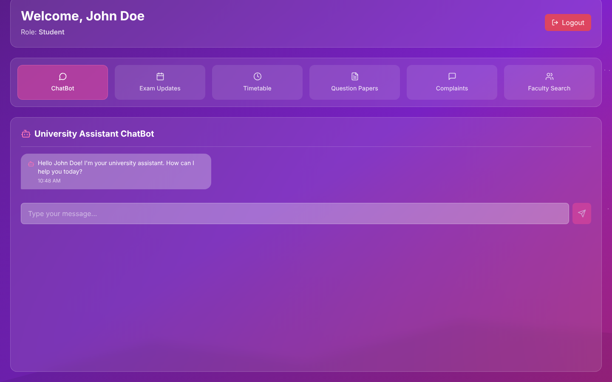
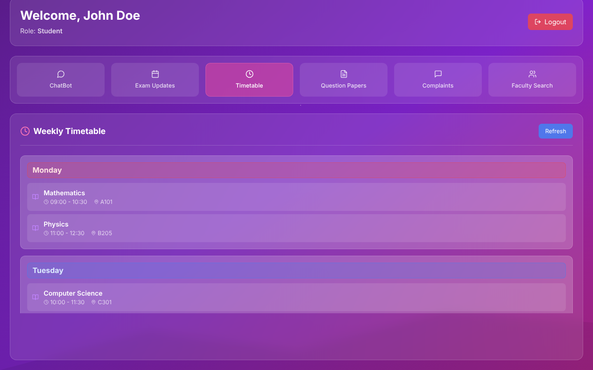
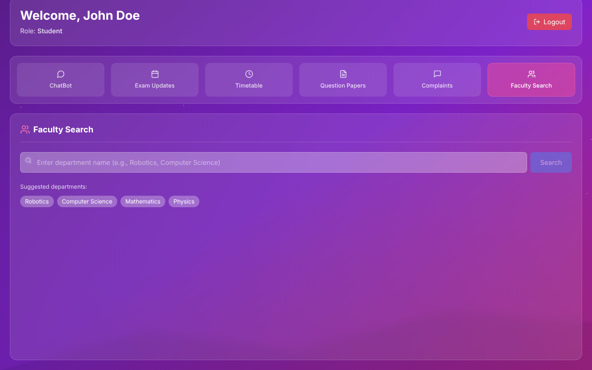

# Unify-Ed — University Assistant

A React + Vite frontend for a university support portal. The app gives students, faculty, and admins a single dashboard for mock chat support, exam notices, timetable viewing, question paper lookup, complaint submission, and faculty discovery.



| Timetable | Faculty search |
|---|---|
|  |  |

This project currently runs entirely on mocked frontend data. The API layer in `src/api.js` simulates network delays and returns hardcoded responses until a backend is connected.

## Features

- Role-based sign-in using demo accounts
- Persistent login with `localStorage`
- Chat assistant with simulated bot replies
- Exam updates with date-based status badges
- Weekly timetable grouped by day
- Question paper search and mock download flow
- Complaint submission form with category and priority
- Faculty search by department with mock WhatsApp links

## Tech Stack

- React 18
- Vite 5
- TypeScript entry setup with JSX components
- Tailwind CSS
- Lucide React icons

## Project Status

This is a frontend prototype.

- Authentication is mocked
- Chat responses are mocked
- Exam, timetable, papers, complaint, and faculty data are mocked
- No Spring Boot backend is connected yet
- No real database or file downloads are wired in yet

## Demo Credentials

Use any of these accounts on the login screen:

- Student: `student@uni.edu` / `1234`
- Faculty: `faculty@uni.edu` / `1234`
- Admin: `admin@uni.edu` / `adminpass`

There is also a hidden admin shortcut button in the bottom-left corner of the login screen that signs in as admin.

## Getting Started

### Prerequisites

- Node.js 18 or later
- npm 9 or later

### Install

```bash
npm install
```

### Run the app

```bash
npm run dev
```

Vite will print a local URL, usually `http://localhost:5173`.

### Build for production

```bash
npm run build
```

### Preview the production build

```bash
npm run preview
```

### Lint

```bash
npm run lint
```

## User Walkthrough

### 1. Sign in

Open the app and log in with one of the demo accounts. After a successful login, the selected user is saved in browser storage so refreshing the page keeps the session active.

### 2. Explore the dashboard

After login, the dashboard header shows the signed-in user's name and role. The navigation area lets you switch between six modules.

### 3. Use the modules

#### ChatBot

- Opens with a welcome message personalized to the logged-in user
- Accepts free-text messages
- Shows a typing indicator while the mock API waits
- Returns one of several placeholder bot responses

#### Exam Updates

- Loads scheduled exams from the mock API
- Formats dates into a readable long form
- Marks items as `Today`, `Tomorrow`, `X days left`, or `Completed`
- Supports manual refresh

#### Timetable

- Loads class schedule data from the mock API
- Groups sessions by weekday
- Displays course, time slot, and room
- Supports manual refresh

#### Question Papers

- Loads previous-year papers from the mock API
- Filters by course name or year
- Includes a mock download button that currently shows an alert instead of downloading a file

#### Complaints

- Lets the user submit a complaint title, category, priority, and description
- Adds logged-in user details to the submitted payload
- Shows a success message after the mocked submission completes

#### Faculty Search

- Lets the user search by department name
- Suggested departments include Robotics, Computer Science, Mathematics, and Physics
- Returns mock faculty members with specialization and WhatsApp links
- WhatsApp action is currently simulated with an alert

### 4. Log out

Click `Logout` in the dashboard header to clear the stored session and return to the login page.

## Folder Structure

```text
src/
  App.tsx                  App shell and login/session switching
  api.js                   Mock API layer for all modules
  index.css                Tailwind imports and global styles
  main.tsx                 React entry point
  components/
    LoginPage.jsx          Login screen and demo account access
    Dashboard.jsx          Main layout and section navigation
    ChatBot.jsx            Chat interface
    ExamUpdates.jsx        Exam notices panel
    Timetable.jsx          Weekly timetable panel
    QuestionPapers.jsx     Paper search and mock downloads
    ComplaintForm.jsx      Complaint submission form
    FacultySearch.jsx      Department-based faculty finder
```

## Data Flow

1. `App.tsx` checks `localStorage` for a previously saved user.
2. `LoginPage.jsx` calls `loginUser()` from `src/api.js`.
3. After login, `Dashboard.jsx` renders the selected feature module.
4. Each module calls its matching mock API helper from `src/api.js`.
5. Responses update component state and drive the UI.

## Backend Integration Notes

The code is already structured so the mock API layer can be swapped for real backend calls later. To connect a Spring Boot backend, the main work will be:

- Replace mock functions in `src/api.js` with `fetch` or `axios` calls
- Move demo credential checks to backend authentication
- Return live exam, timetable, faculty, and complaint data from server endpoints
- Replace alert-based actions with real file downloads and external link handling
- Add environment-based API base URLs

## Known Limitations

- Some displayed dates in the mock exam data are old and will show as completed
- Question paper downloads are not real yet
- WhatsApp actions are not opened yet
- There are no protected backend routes
- There are no automated tests in the project yet

## Suggested Next Steps

- Connect the frontend to a Spring Boot REST API
- Add form validation and better error handling
- Replace mock data with database-backed records
- Add role-based access rules for student, faculty, and admin features
- Add unit and integration tests
- Improve accessibility and keyboard navigation

